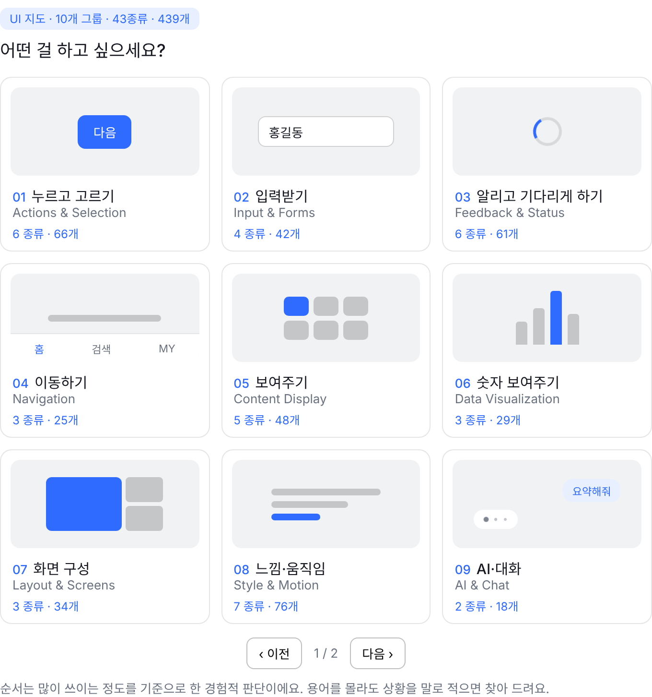
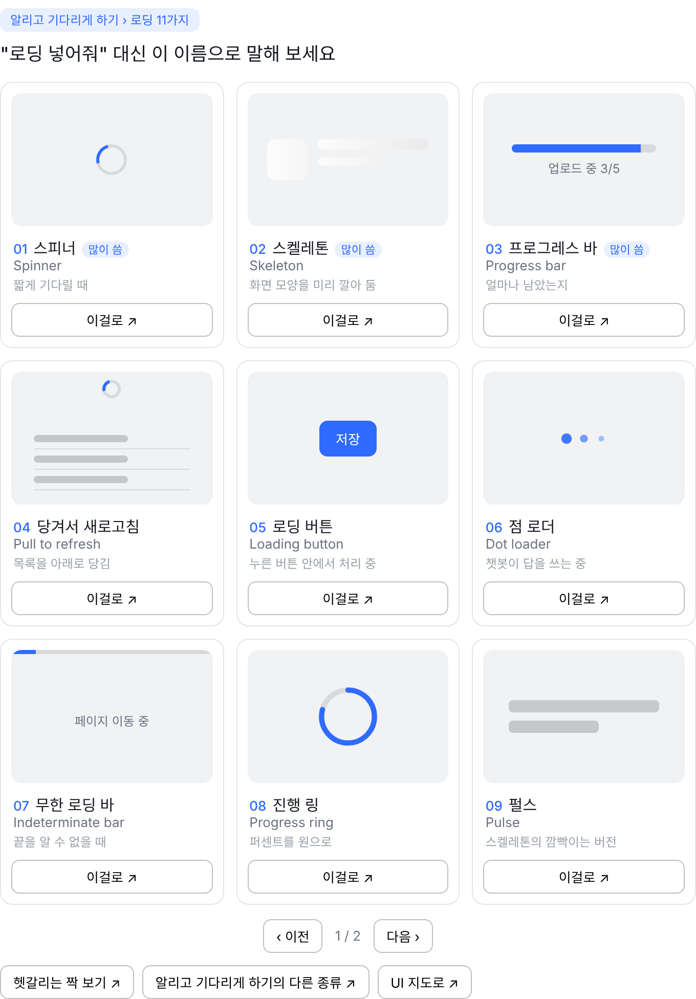
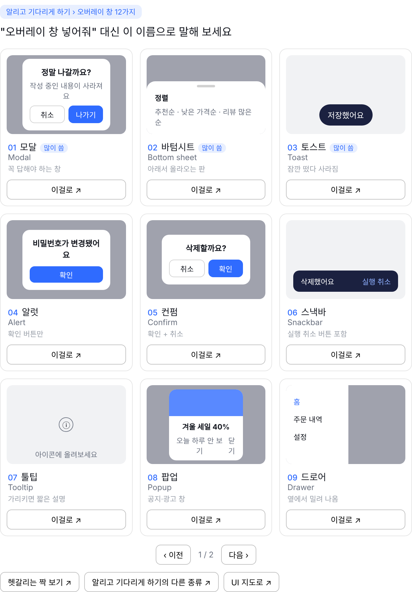
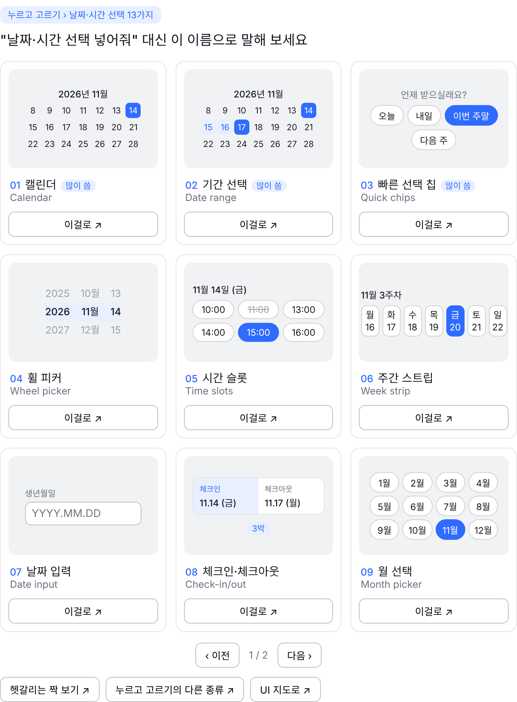
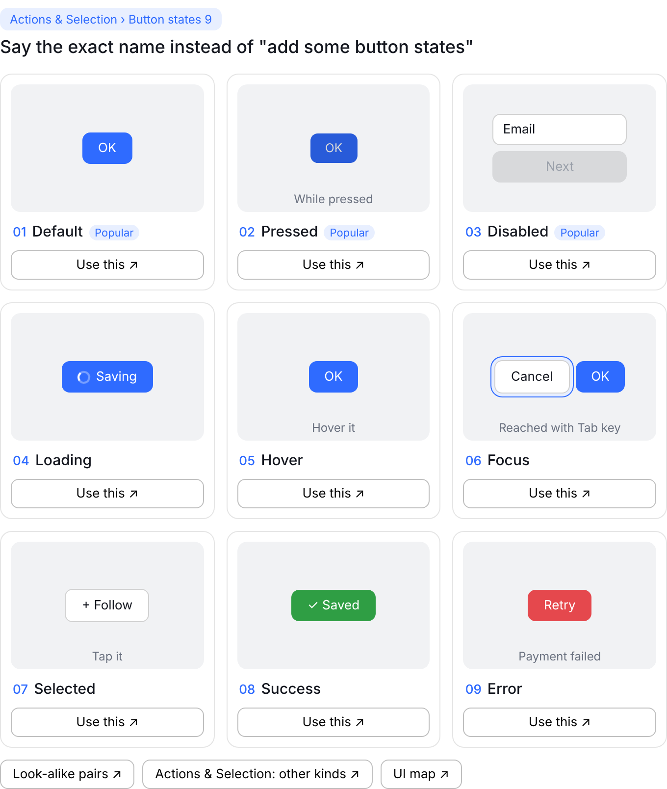

# UI 패턴 피커

[English](README.md) · **한국어**

AI에게 "모던하게 해줘"라고 했는데 평범한 결과가 나온 적 있나요? 대부분은 이름을 몰라서예요. 보면 원하는 걸 알지만, 그게 뭐라고 불리는지 모르는 거죠.

UI 패턴 피커는 **UI 패턴 439개**를 모은 카드 모음입니다. 카드마다 눌러 보고, 입력해 보고, 움직이는 걸 볼 수 있는 **미리보기**가 있어요. 이름은 **한국어와 영어**로, 디자이너와 개발자가 실제로 쓰는 용어를 따랐고, 모든 목록은 많이 쓰이는 순서대로 정렬돼 있습니다.

<p align="center"></p>

## Claude 스킬로 설치하기

스킬을 설치하면 "UI 뭐가 있어", "로딩 보여줘"처럼 물을 때마다 Claude가 이 카드 모음을 불러와 보여 줍니다.

- **Claude 앱 (웹·데스크톱)**: [`ui-pattern-picker-skill.zip`](ui-pattern-picker-skill.zip)을 내려받아 **설정 → 기능 → 스킬**에서 업로드하세요.
- **Claude Code**: 폴더를 스킬 폴더에 복사하세요.
  ```sh
  git clone https://github.com/eminoart/ui-pattern-picker
  cp -r ui-pattern-picker/skill/ui-pattern-picker ~/.claude/skills/
  ```

스킬 파일은 [`skill/ui-pattern-picker/SKILL.md`](skill/ui-pattern-picker/SKILL.md)에 있습니다. 채팅 안에 화면을 띄울 수 있는 앱에서는 카드가 대화창에 바로 나오고, 그렇지 않은 곳에서는 Claude가 열어 볼 HTML 파일을 만들어 줍니다.

## 바로 써 보기 (아무 웹 페이지에서나)

HTML 페이지(또는 HTML을 실행하는 AI 채팅 화면)에 아래 네 줄을 넣으면 됩니다.

```html
<div id="uip"></div>
<script src="https://cdn.jsdelivr.net/gh/eminoart/ui-pattern-picker@main/uip.js"></script>
<script>UIP.show('uip', 'map', 'ko')</script>
```

`UIP.show(요소 id, 대상, 언어)`

| 값 | 넣을 수 있는 것 |
|---|---|
| 대상 | `map`(전체 지도) · 그룹 id · 종류 id · `종류.패턴`(그 카드를 강조, 예: `loading.skeleton`) |
| 언어 | `ko`(한글 이름 + 영문 병기) 또는 `en`(영문 업계 용어) |

## 예시 화면

| 로딩 | 오버레이 창 |
|---|---|
|  |  |

미리보기는 모두 실제로 움직입니다. 스피너는 돌고, 토글은 켜지고, 달력은 눌리고, 입력창은 쓰는 대로 형식이 맞춰져요. 같은 카드를 영어로도 볼 수 있습니다.

| 날짜·시간 선택 | 버튼 상태 (영어) |
|---|---|
|  |  |

## 구성

세 단계로 나뉘고, 각 단계는 한 쪽에 9개씩 카드로 보여 줍니다.

1. **그룹 (10개)**: 하고 싶은 일을 쉬운 말로
2. **종류 (43개)**: 로딩, 오버레이 창 같은 실제 용어
3. **패턴 (439개)**: 미리보기와 "언제 쓰나" 한 줄 설명

카드의 **이걸로** 버튼을 누르면 `UI 패턴 선택: 스켈레톤 (Skeleton) — 알리고 기다리게 하기 › 로딩` 같은 메시지가 채팅으로 전달돼요(`sendPrompt`). 그러면 AI가 언제 쓰는지 설명하고 바로 붙여 넣을 프롬프트를 써 줍니다. 채팅 밖에서는 이 문구가 클립보드에 복사됩니다.

| 그룹 | 종류 |
|---|---|
| `act` 누르고 고르기 | `button` 버튼 · `states` 버튼 상태 · `share` 공유 · `selection` 선택 컨트롤 · `menu` 드롭다운·메뉴 · `date` 날짜·시간 선택 |
| `input` 입력받기 | `text` 입력창 · `search` 검색 · `form` 폼 구성 · `upload` 업로드 |
| `feedback` 알리고 기다리게 하기 | `loading` 로딩 · `overlay` 오버레이 창 · `notification` 알림 · `completion` 완료 표시 · `state` 상태 화면 · `permission` 권한 요청 |
| `nav` 이동하기 | `primary` 메인 내비 · `tabs` 탭 · `wayfinding` 페이지 이동 |
| `display` 보여주기 | `list` 목록 · `card` 카드 · `table` 테이블 · `media` 미디어 · `people` 사람·프로필 |
| `data` 숫자 보여주기 | `chart` 차트 · `metric` 지표 위젯 · `map` 지도 |
| `layout` 화면 구성 | `page` 페이지 레이아웃 · `landing` 랜딩 섹션 · `screens` 앱 필수 화면 |
| `style` 느낌·움직임 | `visual` 비주얼 스타일 · `modern` 모던한 느낌 요소 · `type` 글자 스타일 · `textanim` 텍스트 등장 · `scroll` 스크롤 모션 · `micro` 마이크로인터랙션 · `transition` 화면 전환 |
| `ai` AI·대화 | `chat` 채팅 UI · `aistate` AI 작업 표시 |
| `pairs` 헷갈리는 짝 | `uipairs` UI 짝 · `overlaypairs` 창·알림 짝 · `inputpairs` 입력창 짝 · `icons` 아이콘 짝 |

순서는 널리 쓰이는 앱과 디자인 시스템에서 얼마나 자주 보이는지를 기준으로 한 경험적 판단이며, 측정한 통계는 아닙니다.

## 파일

| 파일 | 내용 |
|---|---|
| `catalog.js` | 모든 이름과 순서. 패턴 하나는 `id~한글~English~한글 설명~English hint` |
| `demos.js`, `demos-1.js` … `demos-5.js` | 미리보기. 키는 `종류.패턴` |
| `demos-h.js` | 미리보기에서 함께 쓰는 작은 도구 |
| `core.js` | 화면 그리기, 쪽 넘기기, 스타일, 동작 |
| `uip.js` | **CDN이 내보내는 완성 파일.** 직접 고치지 마세요 |
| `skill/ui-pattern-picker/SKILL.md` | Claude 스킬 (`ui-pattern-picker-skill.zip`으로도 제공) |
| `build.sh` | `uip.js`를 다시 만들고 모든 미리보기가 도는지 확인 |

## 업데이트하는 법

1. `catalog.js`에서 이름을 추가하거나 순서를 바꿉니다. 목록 안의 위치가 곧 인기 순위입니다.
2. `demos-*.js` 중 한 곳에 미리보기를 추가합니다.
   ```js
   D['loading.skeleton'] = t => `<div class="uip-sk" ...>${t('한국어 문구', 'English text')}</div>`;
   ```
   색은 `--uip-*` 변수를 써야 밝은 화면·어두운 화면에 맞춰집니다. 미리보기가 없는 카드는 "미리보기 준비 중"으로 나와요.
3. `./build.sh`를 실행한 뒤 커밋하고 올립니다.

jsDelivr는 `@main`을 최대 12시간 캐시합니다. 바뀐 걸 바로 보려면 `@커밋해시`로 특정 버전을 불러오세요.

## 라이선스

MIT
