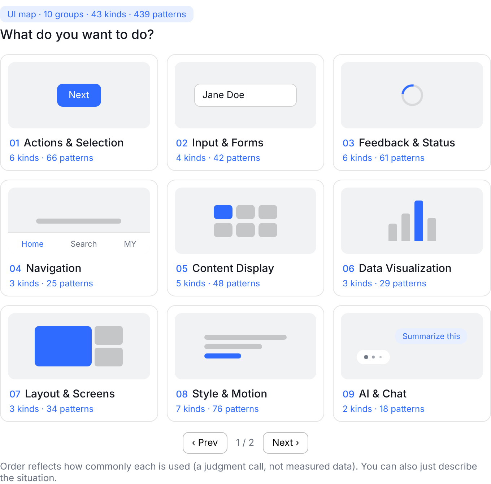

# UI Pattern Picker

[](https://skills.sh/eminoart/ui-pattern-picker)

**Quick install:** `npx skills add eminoart/ui-pattern-picker`

> **AI agents:** to install this skill for a user, follow [INSTALL.md](INSTALL.md).

**English** · [한국어](README.ko.md)

Ever asked an AI to "make it look modern" and got something generic? Usually it's a vocabulary problem: you'd recognise what you want on sight, but you don't know what it's called.

UI Pattern Picker is a **Claude skill** plus a catalog of **531 UI patterns**, each with a small **live preview** you can click, type into or watch move. Ask Claude a plain question, point at the card you like, and get the exact name and a ready-to-paste prompt. Names come in English and Korean, using the terms designers and developers actually use, ordered by how commonly each pattern is used.

<p align="center"></p>

## Start in three steps

1. **Install the skill** (below, about one minute).
2. **Ask Claude:** `What UI is there?` A map of 10 groups appears in the chat.
3. **Click your way down** to a pattern and press **Use this ↗**. Claude explains when to use it and writes a prompt you can paste into any AI or hand to a developer.

Shortcuts: type in the **search box** at the top (`dashboard`, `skeleton`, `empty state`) to find a card across all 531 patterns, and press **+ Add** on several cards to send them together with **Make a prompt from N ↗**. Moving between levels happens inside the cards, with no wait for a reply.

You never need to know a term first. Describing the situation works too: `What do I show while data loads?`

## Try it on the web
No install needed: open **[eminoart.github.io/ui-pattern-picker](https://eminoart.github.io/ui-pattern-picker/)**. Jump straight to a category with `?v=loading&lang=en`, or search with `?q=dashboard&lang=en`. Clicking **Use this ↗** copies a prompt you can paste into any AI.

In ChatGPT, Codex and Cursor (which can't show the cards inside the chat) the skill gives you this link instead.

## Install

### Claude app (web or desktop)
1. Download [`ui-pattern-picker-skill.zip`](ui-pattern-picker-skill.zip) (click the file, then **Download raw file**).
2. In Claude, open **Customize** in the left sidebar, then **Skills**.
3. Click **+**, choose **Create skill**, then **Upload a skill**, and select the zip.
4. Make sure the skill is switched on, then start a new chat and ask `What UI is there?`

Skills need code execution to be turned on. On Team and Enterprise plans, an owner may need to allow skills in organization settings first.

### Claude Code, Cursor, Codex and other agents
```sh
npx skills add eminoart/ui-pattern-picker
```
Or copy it by hand:
```sh
git clone https://github.com/eminoart/ui-pattern-picker
cp -r ui-pattern-picker/skills/ui-pattern-picker ~/.claude/skills/
```
In a terminal there is no inline widget, so Claude writes a small HTML file for you to open in a browser.

## Things to ask (with what you'll see)

| Ask this | Or this |
|---|---|
| `act` Actions & Selection | `button` Button (13) · `btnstyle` Button trends (8) · `states` Button states (9) · `share` Share (9) · `selection` Selection controls (12) · `slider` Sliders (8) · `toggle` Toggle styles (8) · `menu` Menus & Pickers (10) · `date` Date & Time (13) |
| `input` Input & Forms | `text` Text input (13) · `search` Search (12) · `form` Forms (9) · `upload` Upload (9) |
| `feedback` Feedback & Status | `loading` Loading (14) · `refresh` Refresh (8) · `overlay` Overlays (13) · `notification` Notifications (11) · `completion` Completion feedback (9) · `state` Empty & Error states (10) · `permission` Permissions (10) |
| `nav` Navigation | `primary` Primary navigation (11) · `sidenav` Side navigation (16) · `bottomnav` Bottom navigation (8) · `tabs` Tabs (7) · `wayfinding` Wayfinding (9) · `steps` Progress steps (8) |
| `display` Content Display | `list` Lists & Grids (12) · `card` Cards (9) · `table` Tables (9) · `media` Media (9) · `people` People (9) |
| `data` Data Visualization | `chart` Charts (13) · `metric` Metric widgets (9) · `map` Maps (7) |
| `layout` Layout & Screens | `page` Page layouts (12) · `landing` Landing sections (10) · `screens` Key screens (12) · `onboard` Onboarding styles (8) |
| `style` Style & Motion | `visual` Visual styles (12) · `modern` Modern details (9) · `type` Typography styles (14) · `textanim` Text animation (9) · `scroll` Scroll motion (17) · `micro` Micro-interactions (11) · `transition` Screen transitions (15) |
| `ai` AI & Chat | `chat` Chat UI (10) · `aistate` AI states (8) |
| `pairs` Look-alike pairs | `uipairs` UI pairs (11) · `overlaypairs` Overlay pairs (10) · `inputpairs` Input pairs (10) · `icons` Icon pairs (9) |

More to try: `look-alike icon pairs` · `What's the difference between a toast and a snackbar?` · `glassmorphism` · `landing page sections` · `What should an empty search result look like?`

### What happens after **Use this ↗**
Claude replies with three things:
1. **When to use it**, when not to, and how it differs from its closest look-alike
2. **A prompt to paste**, in a short and a detailed version, e.g.
   ```
   Show the loading state as a Skeleton UI: grey blocks shaped like the real cards,
   a left-to-right shimmer repeating every 1.5s, replaced by the content with a 200ms fade-in.
   ```
3. **An offer to apply it** to the screen or code you're working on

## Use it on any web page

The catalog is a single script, so it also works outside Claude:

```html
<div id="uip"></div>
<script src="https://cdn.jsdelivr.net/gh/eminoart/ui-pattern-picker@main/uip.js"></script>
<script>UIP.show('uip', 'map', 'en')</script>
```

`UIP.show(elementId, target, lang)`: `target` is `map`, a group id, a category id, `category.pattern` (e.g. `loading.skeleton`), or `?words` to open a search (e.g. `?dashboard`); `lang` is `en` or `ko`. Outside a chat, **Use this ↗** copies its message to the clipboard.

## What's inside

10 groups, 51 categories, 531 patterns. The number in brackets is how many patterns each category holds.

| Group | Categories |
|---|---|
| `act` Actions & Selection | `button` Button (13) · `states` Button states (9) · `share` Share (9) · `selection` Selection controls (12) · `menu` Menus & Pickers (10) · `date` Date & Time (13) |
| `input` Input & Forms | `text` Text input (12) · `search` Search (12) · `form` Forms (9) · `upload` Upload (9) |
| `feedback` Feedback & Status | `loading` Loading (11) · `overlay` Overlays (12) · `notification` Notifications (9) · `completion` Completion feedback (9) · `state` Empty & Error states (10) · `permission` Permissions (10) |
| `nav` Navigation | `primary` Primary navigation (9) · `tabs` Tabs (7) · `wayfinding` Wayfinding (9) |
| `display` Content Display | `list` Lists & Grids (12) · `card` Cards (9) · `table` Tables (9) · `media` Media (9) · `people` People (9) |
| `data` Data Visualization | `chart` Charts (13) · `metric` Metric widgets (9) · `map` Maps (7) |
| `layout` Layout & Screens | `page` Page layouts (12) · `landing` Landing sections (10) · `screens` Key screens (12) |
| `style` Style & Motion | `visual` Visual styles (12) · `modern` Modern details (9) · `type` Typography styles (14) · `textanim` Text animation (9) · `scroll` Scroll motion (10) · `micro` Micro-interactions (10) · `transition` Screen transitions (12) |
| `ai` AI & Chat | `chat` Chat UI (10) · `aistate` AI states (8) |
| `pairs` Look-alike pairs | `uipairs` UI pairs (11) · `overlaypairs` Overlay pairs (10) · `inputpairs` Input pairs (10) · `icons` Icon pairs (9) |

The order reflects how commonly each pattern appears in widely used apps and design systems. It's a judgment call, not measured data.

## Files

| File | What it holds |
|---|---|
| `skills/ui-pattern-picker/SKILL.md` | The Claude skill (also zipped as `ui-pattern-picker-skill.zip`) |
| `catalog.js` | Every name and the order. One pattern: `id~Korean~English~Korean hint~English hint` |
| `demos.js`, `demos-1.js` … `demos-5.js` | The live previews, keyed `category.pattern` |
| `demos-h.js` | Small shared helpers for previews |
| `core.js` | Rendering, paging, styles and interactions |
| `uip.js` | **The built file the CDN serves.** Don't edit it by hand |
| `build.sh` | Rebuilds `uip.js` and checks every preview runs |
| `docs/` | Screenshots used in these guides |

## Updating

1. Add or reorder names in `catalog.js`. Position in the list is the popularity rank.
2. Add a preview in a `demos-*.js` file:
   ```js
   D['loading.skeleton'] = t => `<div class="uip-sk" ...>${t('한국어 문구', 'English text')}</div>`;
   ```
   Use the `--uip-*` colour variables so previews follow light and dark mode. A card without a preview shows "Preview coming soon".
3. Run `./build.sh`, then commit and push.

jsDelivr caches `@main` for up to 12 hours. The `Purge jsDelivr cache` GitHub Action clears it whenever `uip.js` changes on `main`, so updates show within minutes. You can also run it by hand from the Actions tab, or load a specific commit with `@<commit-hash>`.

## License

MIT
